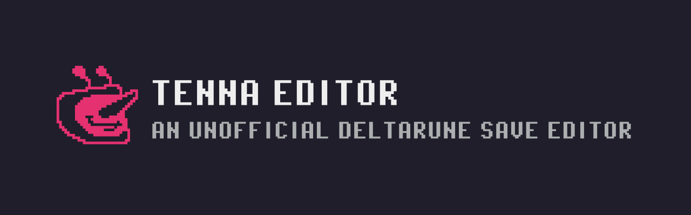
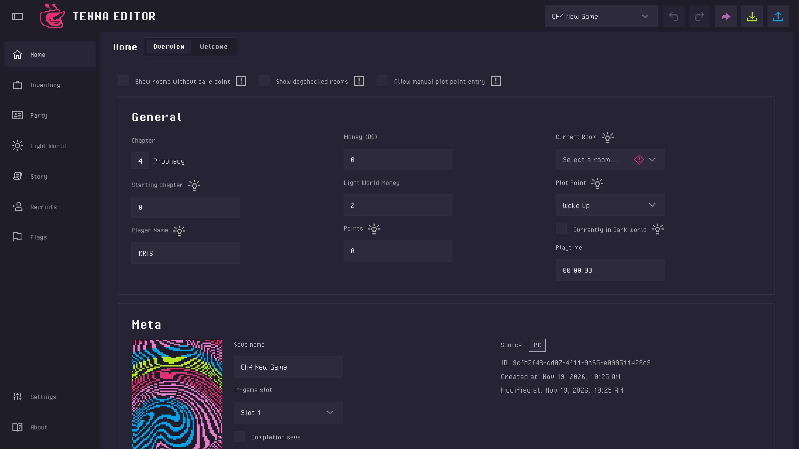
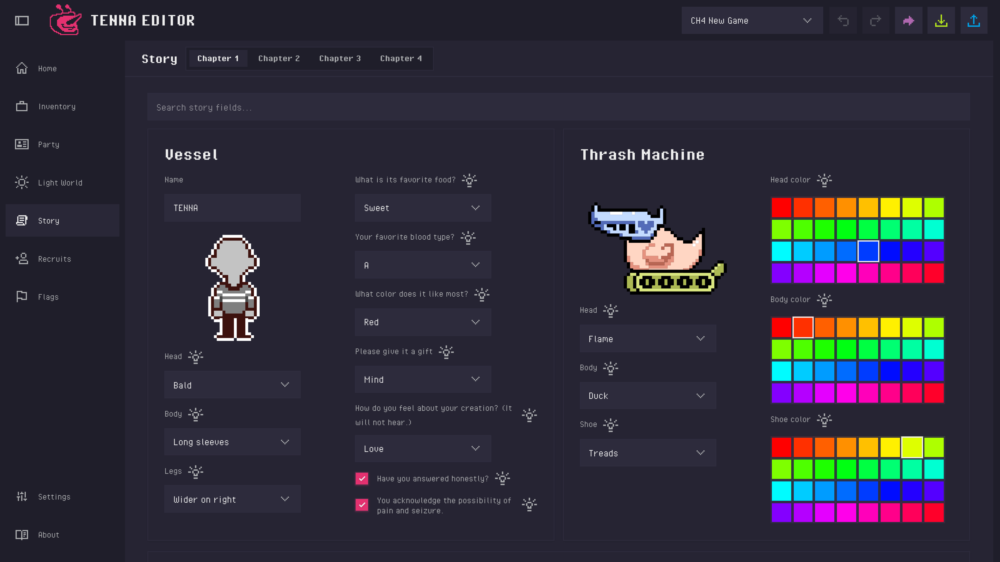
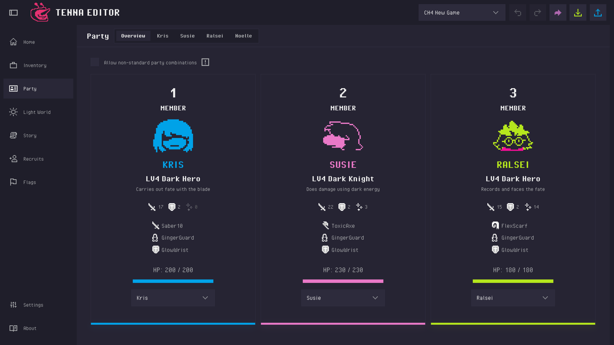
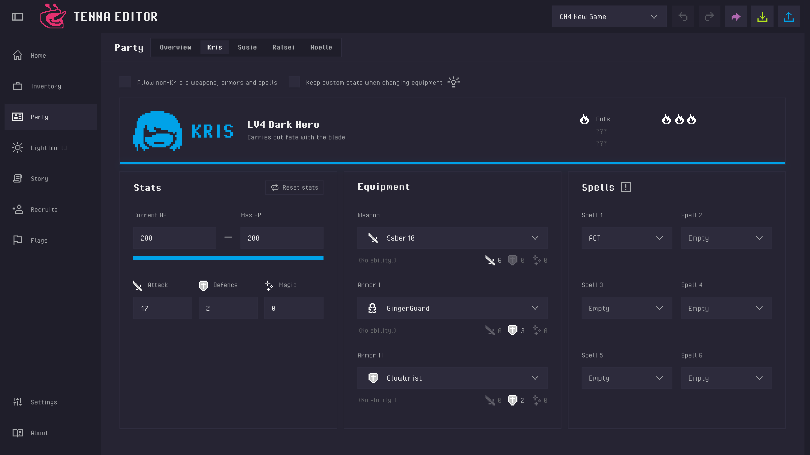
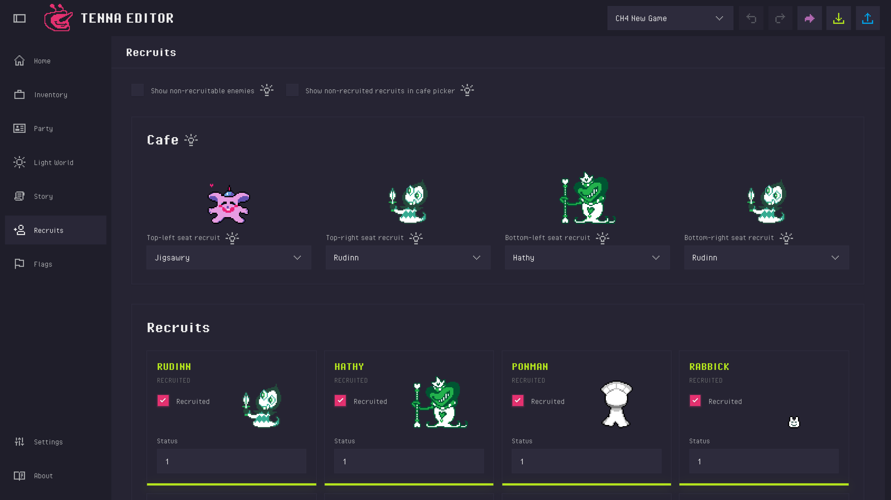
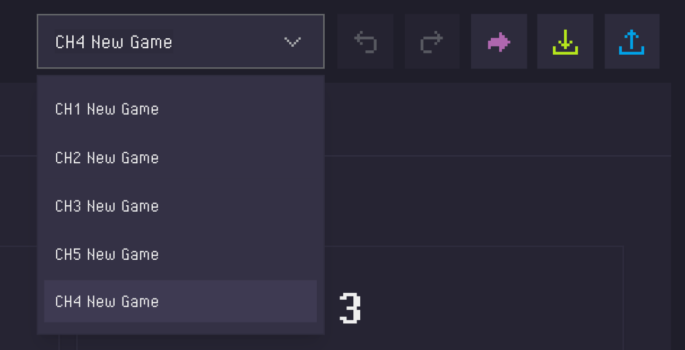
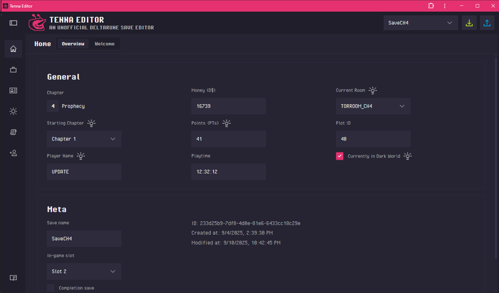
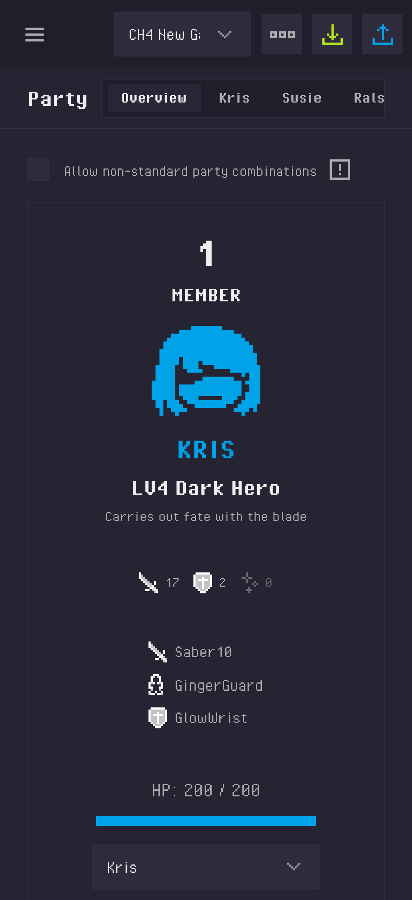

**Use it online: [tennaproject.com](https://tennaproject.com)**

## Motivation

The harsh progression in Chapter 3 motivated me to look for a tool for editing saves.
There is a very popular Spamton Editor out there, which was unavailable when I wanted to use it. After it got back online, it didn't have the features I needed.
I decided to build an alternative that works like a modern web app and doesn't rely on external servers.



## Features

Tenna Editor is a browser-based save editor for DELTARUNE.
It covers the main save data for Chapters 1-5, including inventory, party stats, equipment, Light World data, recruits, rooms, plot progress, and many story flags.
Some flag metadata is still incomplete and may change as it gets verified.

The main editor tabs are:

- Home (overview and basic save options)
- Inventory
- Party
- Light World
- Story
- Recruits
- Flags (advanced flag editor)

Some of them have their own subtabs.
For example, in the Party tab, each character has their own subtab for managing their stats and equipment.

Other features:

- Undo and redo, and a diff view before you download a save.
- Fresh saves for any chapter, so you don't need a save file to start.
- Sharing saves with a link or QR code. The save is stored in the link itself, so it never goes through a server.
- Importing and exporting many saves at once, including from folders and ZIP archives.
- Data packs for extra game data, like items from mods, and support for BetterSaves mod saves.









## One Editor To Edit Everything

Tenna Editor automatically detects the chapter of your save file when you upload it.
It is currently compatible with saves from Chapters 1 to 5.

PC saves (Windows, Mac, and Linux) are the main focus.
Console saves (Nintendo Switch, PS4, and PS5) are experimental. You have to export `deltarune.sav` from your console yourself, because Tenna Editor can't do that for you.

All the saves you make stay in your browser.
You can give them custom names and switch between them whenever you want.
The editor only shows the values and tabs that apply to the chapter of your current save.
Settings also let you back up and restore your saves.

_Please back up your original saves before editing them._



## All Inside Your Browser

Tenna Editor runs entirely in your browser. Your saves are processed on your device and never sent anywhere.

You can also install Tenna Editor as an app (PWA) on browsers and devices that support it. It gets its own shortcut and window, and it works offline.



## Works Everywhere (almost)

Tenna Editor is mostly designed for widescreen, but it works fine on phones too, with every feature available.



## Name and Design

I really enjoyed the character Tenna while playing Chapter 3.
Combined with the existence of Spamton Editor, that made naming it after Tenna an instant decision. Spamton and Tenna are closely related characters, as you probably already know.

**You can't get this from an EGG!**

I put a lot of effort into making the layout look distinct and directly inspired by Tenna's colors. The design went through many iterations. I also tried to incorporate additional design elements inspired by Tenna, such as some yellow accents, but they didn’t fit well. I'm not a big fan of designing user interfaces in general, so I welcome any suggestions!

## Special Thanks

- Toby Fox and the whole team behind DELTARUNE - for creating the game.
- [Spamton Editor](https://saveeditor.spamton.com) - for being a direct inspiration.
- [Flowey's Time Machine](https://crumblingstatue.github.io) - for being another inspiration.
- [Jacky720's "Flowey's Time Machine" fork](https://github.com/Jacky720/FloweysTimeMachine/tree/deltarune) - for save data research and references that helped with a lot of Tenna Editor's data mapping.
- [DELTARUNE Wiki](https://deltarune.wiki) - for lots of useful information that sped up the process of building this project significantly.
- [Undertale Mod Tool](https://github.com/UnderminersTeam/UndertaleModTool) - for letting me dig through the game code and assets to understand how things work.

## Contributors

- [@afreetoplaynoob](https://github.com/afreetoplaynoob)
- [@Araraura](https://github.com/Araraura)
- cpu-99999999999
- [@jah-yee](https://github.com/jah-yee)
- [@jimmy-fun-fact](https://github.com/jimmy-fun-fact)
- [@jjezewski](https://github.com/jjezewski) - creator & maintainer
- john
- [@krisgrant](https://github.com/krisgrant)
- [@lori2012real](https://github.com/lori2012real)
- [@Matojeje](https://github.com/Matojeje)
- [@MiaouKING](https://github.com/MiaouKING)
- [@newhajinyoon](https://github.com/newhajinyoon)
- [@soulware1](https://github.com/soulware1)
- [@wryyyong](https://github.com/wryyyong)
- [@xanderrock98](https://github.com/xanderrock98)

## Development

The project uses [Bun](https://bun.sh/) for dependency management, package scripts, and its JavaScript runtime.

> [!WARNING]
> Node.js/npm is not supported. It may currently work in some cases, but the
> project does not provide an npm lockfile or test Node-based workflows.

You can also open the repository in the provided [Dev Container](https://containers.dev/) for a preconfigured environment.

Install dependencies:

```bash
bun install --frozen-lockfile
```

### Running

Start a development server (served at `127.0.0.1:4500`):

```bash
bun run dev
```

### Building

Create a production build:

```bash
bun run build
```

Preview the production build locally (served at `127.0.0.1:4545`):

```bash
bun run preview
```

### Contributing

Run linting, format checking, and the type-checked build before submitting changes:

```bash
bun run check
```

## License

This project is licensed under the zlib License. See the [LICENSE](./LICENSE) file for details.

### Name And Branding Notice

The "Tenna Editor" name, logo, and branding assets are **not** covered by the zlib License and may not be used to brand other instances or derivatives of this project. If you fork or rehost this project, use your own name and branding. See [BRANDING.md](./BRANDING.md) for details.

### DELTARUNE™ Assets Notice

The assets under `src/assets/deltarune/` are from DELTARUNE™ and copyrighted by Toby Fox. They are used under fair use for this non-commercial, transformative project. No endorsement is implied. See [NOTICE.md](src/assets/deltarune/NOTICE.md) for full details.
